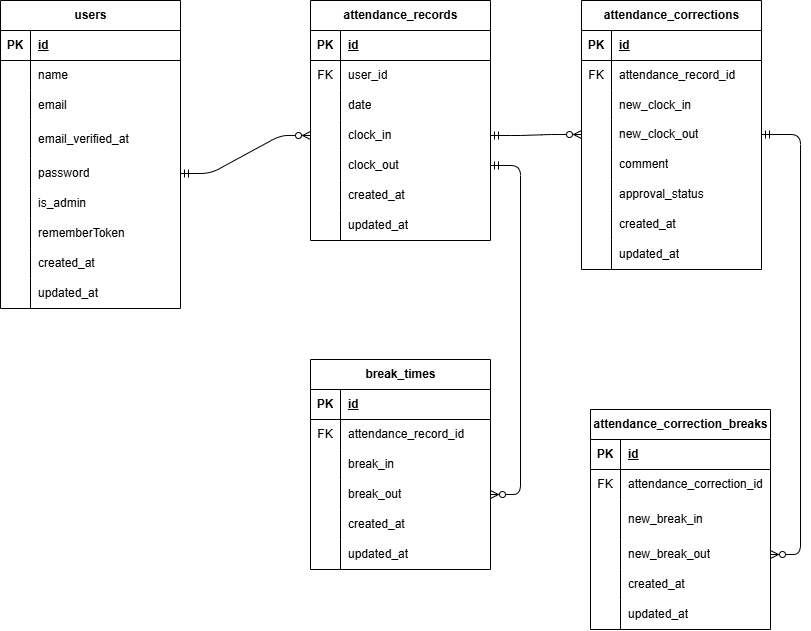

# アプリケーション名  
COACHTECH 勤怠管理アプリ  

# 概要  
- 目的  
    実践に近い開発経験を積み、定義された要件を実装する能力を身につけること  
    
- 実装機能  
    認証: ユーザー登録、メール認証、ログイン（一般ユーザー・管理者）、ログアウト  
    出勤登録（一般）: 出勤・休憩・退勤処理  
    勤怠（一般）: 勤怠一覧・勤怠詳細・申請一覧・勤怠統計レポート画面表示、勤怠修正申請処理  
    勤怠（管理者）: 勤怠一覧・勤怠詳細・スタッフ一覧・スタッフ別勤怠一覧画面表示、勤怠修正処理  
    申請承認（管理者）: 申請一覧・申請承認画面表示、承認処理、CSVエクスポート  
    API: お問い合わせのCRUD処理（一覧、詳細、作成、更新、削除）  

# 環境構築
Laravel環境構築  

1. ```git clone git@github.com:Kazuki-Yamaoka/attendance-app.git```
2. ```cd attendance-app```   

＊ MySQLは、OSによって起動しない場合があるのでそれぞれのPCに合わせて docker-compose.yml ファイルを編集してください。  

3. パッケージをインストール
    ```
    docker run --rm \
        -u "$(id -u):$(id -g)" \
        -v "$(pwd):/var/www/html" \
        -w /var/www/html \
        laravelsail/php82-composer:latest \
        composer install
    ```
4. ```cp .env.example .env```
5. ```./vendor/bin/sail up -d```
6. ```./vendor/bin/sail artisan key:generate```
7. .env ファイルを開き、データベース接続情報が以下と一致していることを確認します。
    ```
    DB_CONNECTION=mysql
    DB_HOST=mysql
    DB_PORT=3306
    DB_DATABASE=laravel
    DB_USERNAME=sail
    DB_PASSWORD=password

    MAIL_MAILER=smtp
    MAIL_HOST=mailpit
    MAIL_PORT=1025
    ```
8. ```sail npm install```
    > 重要: sail npm install を実行する前に、必ずSailコンテナが起動していることを確認してください。
9. ```sail npm run dev```
10. ```sail artisan migrate --seed```  
    ※既存のデータベースをリセットしたい場合は以下を実行してください。  
    ```sail artisan migrate:fresh --seed```
11. ```sail artisan test```

# 使用技術（実行環境）
- PHP: 8.5.9
- Laravel: 10.50.3
- Composer: 2.10.3
- MySQL: 8.4.11
- Docker: 29.7.2
- Docker Compose: 5.5.0
- npm: 12.0.2
- Git: 2.53.0

# ER図
  

# APIエンドポイント一覧
- GET /api/v1/attendance-records　勤怠一覧
- GET /api/v1/attendance-records/{attendanceRecord}　勤怠詳細
- POST /api/v1/attendance-records　勤怠登録
- PUT /api/v1/attendance-records/{attendanceRecord}　勤怠更新
- DELETE /api/v1/attendance-records/{attendanceRecord}　勤怠削除

# URL
- 開発環境: http://localhost/
- 会員登録画面（一般ユーザー）: http://localhost/register
- ログイン画面（一般ユーザー）: http://localhost/login
- 出勤登録画面（一般ユーザー）: http://localhost/attendance
- 勤怠一覧画面（一般ユーザー）: http://localhost/attendance/list
- 勤怠詳細画面（一般ユーザー）: http://localhost/attendance/detail/{id}
- 申請一覧画面（一般ユーザー）: http://localhost/stamp_correction_request/list
- 勤怠統計レポート画面（一般ユーザー）: http://localhost/attendance/report
- ログイン画面（管理者）: http://localhost/admin/login
- 勤怠一覧画面（管理者）: http://localhost/admin/attendance/list
- 勤怠詳細画面（管理者）: http://localhostadmin/attendance/{id}
- スタッフ一覧画面（管理者）: http://localhost/admin/staff/list
- スタッフ別勤怠一覧画面（管理者）: http://localhost/admin/attendance/staff/{id}
- 申請一覧画面（管理者）: http://localhost/stamp_correction_request/list
- 修正申請承認画面（管理者）: http://localhost/stamp_correction_request/approve/{attendance_correct_request_id}
- Mysql : http://localhost:8080/
- mailpit : http://localhost:8025/

# 作成者
山岡 一幾